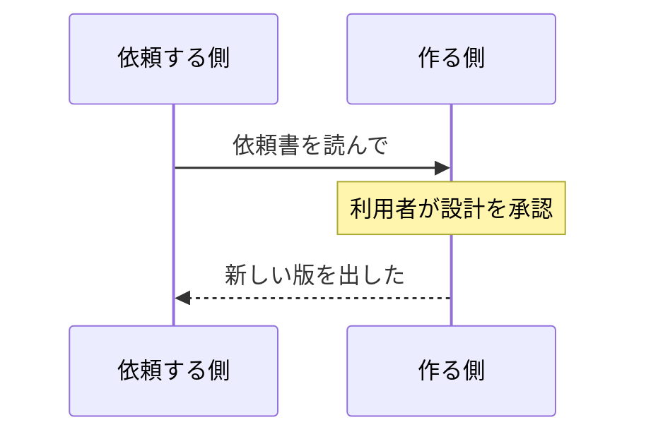

# 設計メモ: Markdown のページで Mermaid の図を描く

> **このドキュメントの位置づけ**
> 利用者からの依頼に対する設計。2026-10-29 に調査と計測をし、同日に利用者が承認した (§4)。
> 決まったことは [project-overview.md](project-overview.md) §7 に 1 行ずつ移す。
> このファイルは「なぜその形にしたか」と、計測の結果・却下した案を残すための記録。

---

## 1. 何を作るか

種別 Markdown のページで、`mermaid` と書いたコードブロックを図にする。

````markdown

````

- 描くのは**ブラウザ**。サーバーは今までどおりコードブロックを出し、図のあるページにだけ
  描くためのスクリプトを 1 つ足す。
- 図の元は本文にそのまま残る (履歴・差分・検索・`app/tool/page` で読み書きできる)。
- 同じ書き方は GitHub・GitLab・Obsidian などでも図になる。

## 2. 調べてわかったこと

### 2.1 版の候補

依頼書が測った 11.17.2 は 11 系の最後の版で、最新は **12.2.0** (2026-10-13) だった。

| | 11.17.2 | 12.2.0 全部入り | 12.2.0 分割版 | 12.2.0 tiny |
|---|---|---|---|---|
| 形 | 全部入り 1 本 (3.5 MB) か分割版 (入口 30 KB + 部品 101 個 3.5 MB) | 1 本 5.4 MB | 入口 + 部品 (ELK の部品 1.6 MB を含む) | 1 本 2.7 MB |
| ELK (EPL-2.0) | **含まない** | **含む** | 遅延で読む部品 1 つに入っている | 含まない |
| ブラウザ | **Safari 16.4 以上** (ES2022 のクラスの静的ブロックを 536 箇所使う) | **Safari 17.4 以上** (ES2024) | 同左 | 同左 |
| 描けない図 | なし | なし | なし | マインドマップ・アーキテクチャ図・数式 |
| 見た目 | 今の GitHub などと同じ | 流れ図などの配置と色が変わる (ELK が既定、新しい見た目 `neo`) | 同左 | 同左 |

- 12 系の全部入りは ELK を 1 本のファイルの中に埋め込んでいて、取り出せない。ELK のライセンスは §2.6。
- ELK を除く部品 (約 70 個) のライセンスは MIT・ISC・BSD-3-Clause・Apache-2.0・
  (MPL-2.0 か Apache-2.0) で、すべて GPLv3 と両立する (npm の登録情報で確認)。
- 数式 (KaTeX) は全部入りと分割版にあり、tiny には無い。
- **Mermaid は前の大きな版にも安全上の修正を出し続けている。** 10.9 系は 11.0 (2024-08) の
  あとも 2026-08 まで修正版が出た (10.9.2〜10.9.8)。11 系も当面は修正が出ると見てよい。
- 安全上の勧告は多い。2025〜2026 年だけで XSS 2 件 (critical)、CSS の差し込み 4 件、
  無限ループ (閲覧者のブラウザが固まる) 3 件など。**追随する手順が要る**。

### 2.2 prototype.js とぶつかる (計測で確かめた)

NextForm は全ページで prototype.js 1.7.2 を読んでいる。これが組み込みを書き換えている。

| 書き換え | 起きること |
|---|---|
| `Array.from` を自前の `$A` に置き換える | Set・Map・`{length: n}` を渡すと空や中身なしの配列が返る |
| 配列の `entries()` を「配列を返す」ものに置き換える | `for (const [i, x] of a.entries())` が壊れる |
| `Object.values` を for…in 版に置き換える | 継承したプロパティまで拾う |
| 配列・文字列などに数え上げられるメソッドを足す | 配列を for…in で回すと、メソッドまで拾う |

計測ページで 23 種類の図を「prototype.js なし」「あり」で描き比べた (Chrome・Firefox、5 候補)。

- **そのままだと 23 種類中 8〜11 種類が誤りで止まる** (ER 図・ガント・タイムライン・C4 など。
  12 系の全部入りでは流れ図・クラス図・状態図も)。シーケンス図は止まらないが、`loop` の札が
  `o`、`[毎日]` が `毎` に化ける。
- 上の 3 つを戻すと、止まるものは無くなった。ただ流れ図の線の `style` 属性に、prototype.js の
  メソッドのソースがまるごと入った (図が 18 KB → 64 KB)。4 つ目 (for…in) が原因。
- **4 つ目も手当てする (prototype.js が足したものを for…in で数えないようにする) と、
  5 候補すべてで「prototype.js なし」と同じ図になった。** 残る違いは「なし」同士でも出るもの
  (クラス図・ER 図・gitGraph・アーキテクチャ図・要求図の乱数の id) と、journey の属性の並び順だけ。

NextForm 自身のスクリプト (`resource/script/*.js`、テーマの `theme.js`) は上の 3 つを
使っていない (grep で確認)。図のあるページでだけ戻せば、ほかのページには何も起きない。

### 2.3 計測 (開発検証サイト、2026-10-29)

開発検証サイトの実際の Markdown のページ (図 2 つ: シーケンス図と流れ図、日本語) に、
候補を 1 つずつ読ませた。Windows の Chrome 155。各 4 回の中央値。

| 候補 | 図が出るまで (初回 / 2 回目以降) | 画面が固まる時間 (初回 / 2 回目以降) | 転送 | ファイル数 |
|---|---|---|---|---|
| 図なし (今と同じ) | — / 99 ms | — / 0 ms | 0 | 0 |
| 11.17.2 全部入り | 518 / 245 ms | 115 / 82 ms | 3.5 MB | 1 |
| 11.17.2 分割版 | 615 / 279 ms | 20 / 6 ms | 0.95 MB | 29 |
| 12.2.0 全部入り (ELK 入り。参考) | 864 / 361 ms | 206 / 76 ms | 5.4 MB | 1 |
| 12.2.0 分割版 (dagre) | 629 / 291 ms | 40 / 8 ms | 0.98 MB | 30 |
| 12.2.0 tiny | 508 / 261 ms | 169 / 94 ms | 2.7 MB | 1 |

- 「画面が固まる時間」は 50 ms を超えた長いタスクの超過分の合計 (Total Blocking Time)。
- 開発検証サイトは JavaScript を圧縮せずに送っている。圧縮するサーバーなら転送は 1/3 ほど。
- 転送は版ごとに初回だけ。2 回目以降はブラウザのキャッシュから読む。
- Firefox でも傾向は同じ (11.17.2 全部入り: 初回 985 ms / 2 回目以降 418 ms)。
- メモリは同じページの中で「読む前」と「描いた後」を `performance.measureUserAgentSpecificMemory()`
  で測った差 (計測用のディレクトリだけをクロスオリジン分離にした)。図なし ±0 MB、
  11.17.2 全部入り +2.1 MB、11.17.2 分割版 +2.0 MB、12.2.0 全部入り +5.7 MB、
  12.2.0 分割版 +2.1 MB、12.2.0 tiny +2.2 MB。**11.17.2 の全部入りと分割版に差は無い。**
  (ページをまたいで測った 1 回目は、回を追うごとに候補によらず 80 → 200 MB と増え、読めなかった)

**読み取れること**: 11.17.2 の全部入りと分割版は、図が出るまでの時間 (245 / 279 ms) も
メモリ (+2 MB) も同じ。分割版が勝つのは「固まる時間」(82 → 6 ms) と初回の転送 (3.5 → 0.95 MB)。
全部入りが勝つのは運用 (1 本の `.js` なので MIME の心配が無く、上げても古いファイルが残らない。
§2.5)。82 ms は、ページの本文が出たあとに 1 回だけ起きる。

**採った 12.2.0 の全部入り** (§4) は、図が出るまで 361 ms (2 回目以降)、固まる時間 76 ms、
メモリ +5.7 MB、転送 5.4 MB。11.17.2 より重いのは、ELK と新しい描き方の分。

### 2.4 既存の仕組みに乗れるところ

- **図のあるページでだけスクリプトを読む口がある。** wiki 記法のコードの色付けが
  `head_tags_add_javascript('resource/script/prettify.js')` を同じ形で使っている。
- **部分編集はそのまま効く。** コードブロックの `<pre>` に原文の位置 (`data-twp`・`data-twl`) が
  付いている。`<pre>` を残して中身だけ図に差し替えれば、ダブルクリックで原文が開く。
  保存すると画面全体を読み直すので、新しい図が描かれる。
- **プレビューもそのまま描ける。** プレビューは保存せずに画面全体をサーバーで描き直す作り
  (`markdown_write()` → `markdown_convert()`) なので、表示と同じ経路で script が付く。
- **`:::example` も図になる。** 「ソース」側は素の `<pre>`、「表示」側はコードブロックなので、
  マニュアルで書き方と図を並べられる。


### 2.5 気をつけるところ

- **strict でも、ラベルに書いた HTML の多くが通る。** 流れ図などは既定でラベルを HTML で描き
  (`htmlLabels`)、strict のときはラベルを **DOMPurify の既定の設定**に通すだけ
  (`mermaid.js` の `sanitizeMore()`・`sanitizeText()`)。スクリプトは落ちるが、`<form>`・`<input>`・
  `<button>`・`style=` 属性・外部の `` は残る。**図の中に偽のログイン欄を出せる。**
  Markdown の生 HTML を既定で文字にしている方針 (`MARKDOWN_ALLOW_HTML`) と食い違う。
  Mermaid の設定 `dompurifyConfig` で許すものを絞れる。この項目は Mermaid の既定の設定に無いので、
  図の中の `%%{init}%%` やフロントマターからは変えられない (`sanitizeDirective()` が消す)。
- **ツールチップは DOMPurify の既定の設定のまま。** `bindFunctions` を呼ぶと、ノードの `title` が
  HTML としてページに出る。呼ばなければ出ない。
- **サイドページの図は、本文に図があるページでだけ描かれる。** サイドページは `<head>` を書き出した
  あとに描いているので、そこで script を足しても間に合わない。wiki 記法のコードの色付け
  (prettify.js) にも同じ制約がある (既存の問題として別に報告する)。
- **暗い色調では図が読めない。** Mermaid の既定の色は白地向けで、背景は透明。色調
  「ブラック/ブルー」(背景 #111) では線と文字が沈む。
- **本文より広い図は、既定では縮む** (`useMaxWidth`)。携帯ではシーケンス図の文字が小さくなる。
- **大きすぎる図は、コードが消えて英語の赤い箱になる。** `maxTextSize` (5 万字) を超えると、
  Mermaid は誤りを投げずに中身を差し替える。
- **保存した後のスクロール位置がずれる。** 部分編集で保存すると、nextform.js が読み込み直後に
  元の位置へ戻す (`scrollSetup()`)。その時点では図はまだコードで、図に差し替わると高さが変わる。
- **Mermaid の中に DOMPurify 3.4.12 が入っている。** DOMPurify の修正も、Mermaid の新しい版を
  待つことになる。
- 分割版は拡張子 `.mjs` のファイルが 100 個あまり。**サーバーが `.mjs` を JavaScript として
  返さないと動かない** (モジュールは MIME を厳しく見る)。開発検証サイトは返すが、共用サーバーと
  `php -S` は保証が無い。
- 分割版は部品の名前に中身のハッシュが入る。Mermaid を上げるたびに部品の名前が全部変わり、
  **アップグレードの道具は古い部品を消さない** (方針「消さない」)。上げるたびに約 100 個の
  使われないファイルが残り、道具の「配布物に無いファイル」に毎回並ぶ。
- 計測は卓上の Chrome と Firefox だけ。携帯は CPU が数倍遅いので、「固まる時間」も数倍になる
  (全部入りで 300〜500 ms ほどと見込む。分割版は 30 ms ほど)。

### 2.6 ELK のライセンス

ELK (Eclipse Layout Kernel) は図の部品の並べ方を計算するエンジン。Mermaid は長く dagre を使い、
11 系では ELK は別のパッケージ (入れたい人だけが足すもの) だった。12.0 で本体に入り、流れ図・状態図・
クラス図・ER 図などの既定の配置になった。12.2.0 が入れているのは **elkjs 0.9.3** (ELK 0.9.1 を
GWT で JavaScript にしたもの)。

| 部品 | ライセンス | 確かめた所 |
|---|---|---|
| ELK 0.9.1〜0.10.0 | EPL-2.0 だけ (配置の本体の見出しは `SPDX-License-Identifier: EPL-2.0`) | eclipse/elk の各タグのソース |
| **ELK 0.12.0 (2026-07) 以降** | **EPL-2.0 OR GPL-3.0-or-later** (Secondary License の通知を全体に付けた。eclipse/elk #1184) | 同上。npm の elkjs も 0.12.0 から同じ |
| elkjs の包み (`elk-api.js` など) | 0.9.3 は EPL-2.0、0.12 は二重ライセンス | kieler/elkjs |
| elkjs が中に組み込む EMF (GWT 版 2.12.4、`com.genmymodel.emf.gwt`) | **EPL-1.0** (Secondary License の仕組みが無い) | Maven Central の POM |
| elkjs が中に組み込む Xtext の実行用ライブラリ (xbase lib・xtend lib) | EPL-2.0 (GPL の指定は見当たらない) | Maven Central の POM |
| elkjs が中に組み込む Guava・GWT | Apache-2.0 | |

- Mermaid の開発中の版 (develop) は 2026-10-28 に elkjs を 0.12 に上げた (mermaid-js/mermaid #8532)。
  次の版からは ELK 本体は GPL と両立する。EMF と Xtext の分は残る。
- 12.2.0 の `mermaid.min.js` には ELK の条文も著作権表示も残っていない。同梱するときに自前で添える。

**どう扱うか (利用者の判断 2026-10-29)**: 12.2.0 の全部入りを同梱し、Mermaid を呼ぶ NextForm の
ファイル (`diagram.js`) に GPLv3 §7 の**追加の許可**を付ける。同梱物の規約を改める (§3.7)。

- Mermaid を呼ぶ GPL のコードは、今回新しく書く `diagram.js` だけ。上流から受け継いだコード (PHP・
  nextform.js) は Mermaid を呼ばない (サーバーは `<script>` と `<meta>` を出すだけ)。
- §7 では、著作権を持つ人が自分の書いた部分に許可を足せる。`diagram.js` を「Mermaid とその同梱物を
  それぞれのライセンスのまま組み合わせて配ってよい」とする (GCC の実行時ライブラリの例外などと同じ型)。
- そのために `diagram.js` は nextform.js の関数を呼ばない。画面の文言はサーバーから `<meta>` で受け取る。
- 法的に確実かを専門家に確かめたものではない。解釈の幅を狭める手当て。

却下した案:

| 案 | 却下の理由 |
|---|---|
| 11.17.2 (ELK を含まない) | 最初の推し。いずれ 12 へ上げるときに同じ判断が来る。利用者は 12 を選んだ |
| 12.2.0 tiny (ELK を含まない公式の版) | 数式 (KaTeX) が入っていない。マインドマップ・アーキテクチャ図も描けない |
| 12.2.0 分割版から ELK の部品だけ外す | `.mjs` を JavaScript として返さないサーバーでは図が出ない。上げるたびに古い部品が約 100 個残る (§2.5)。Mermaid の配布物から 1 ファイル抜いて配ることになる |
| 同梱せず、設置のときに npm から取ってくる | 「展開するだけで動く」(§7 ライブラリの持ち方: 設置先はシェルも外向き通信も無いことが多い) とぶつかる。取ってくる口が 3 つ (インストーラ・アップグレード・管理画面) と tgz の展開が要る。各サイトが訪問者のブラウザに両方を送るので、組み合わせの問いは各サイトへ移るだけ |

## 3. 設計

「(判断)」は作る側の判断で、利用者は読んで直せる。

### 3.1 全体の流れ

```
サーバー (markdown.inc)                         ブラウザ (resource/script/diagram.js)
---------------------------------               ------------------------------------------
本文を変換する (今まで通り)                       DOMContentLoaded
<pre data-twp data-twl>                          section.markdown の pre > code.language-mermaid を探す
  <code class="language-mermaid">…</code>          無ければ何もしない
</pre>                                           prototype.js が書き換えた組み込みを戻す (§3.3)
コードブロックに mermaid があり、                   mermaid.min.js を読む (async)
設定が「描く」なら                                 1 つずつ描く
  head に diagram.js と <meta> を足す               描けた → <pre> の中身を図に差し替える
                                                   描けない → コードを残し、下に誤りを出す
```

- **図の無いページの HTML は 1 バイトも変わらない。** 読み込むものも増えない (条件 2)。
- 図のあるページで増えるのは `<head>` の `<meta>` と `<script>` だけ。本文 (`<article class="main">`) の
  HTML は変わらない。

### 3.2 サーバー側

- `markdown_convert()` の後処理で、`section.markdown` の中に `pre > code.language-mermaid` があれば、
  `head_tags_add_javascript('resource/script/diagram.js')` と `<meta>` を足す。prettify.js と同じ口。
  - `<meta>` で渡すもの: Mermaid の URL (`head_tags_asset_url()` で作り、**ファイルが変わったときだけ
    変わる**) と、画面の文言 (サーバーの `l()` で訳したもの)。`<meta>` の形は既存の
    `nextform-post-encoding` と同じ。
  - 表示・プレビュー・取り込み (``、wiki の `&include`)・添付した md の表示は、どれも
    `markdown_convert()` を通るので同じ扱いになる。
  - 言語名は大文字小文字を区別しない (`Mermaid` も図にする) (判断。GitHub と同じ)。
- サイト設定 `MARKDOWN_DIAGRAM` が `false` のときは足さない。図はコードのまま。

### 3.3 ブラウザ側 (`resource/script/diagram.js`、新規)

ES5 で書く (判断。古いブラウザでも構文エラーにならず、「描けない」を出せるように)。冒頭に GPLv3 と
§7 の追加の許可を書く。nextform.js の関数は呼ばない (§2.6)。

1. 図にするコードブロックを探す。無ければ終わる。
2. **prototype.js が書き換えた組み込みを戻す。** 一時的な `iframe` から `Array.from`・
   `Array.prototype.entries`・`Object.values` を写して `iframe` を外し、`Array`・`String`・`Number`・
   `Function`・`Date`・`RegExp` の prototype に足されたものを数え上げないようにする (`enumerable: false`)。
   図のあるページでだけ、1 度だけ行う。NextForm のスクリプトはこれらに頼っていない (§2.2)。
3. `<meta>` の URL の `mermaid.min.js` を `<script async>` で読む。**読めたかは `window.mermaid` が
   あるかで見る** (古いブラウザでは構文エラーでも `onload` が呼ばれる)。読めなければ、コードを残して
   「このブラウザでは図を描けません」と出す。
4. 設定:
   - `startOnLoad: false`、`securityLevel: 'strict'`、`suppressErrorRendering: true`
   - **`dompurifyConfig` でラベルに許す HTML を絞る**: 飾り (太字・斜体・下線・打ち消し・改行・
     上付き・下付き・`span`・`div`・`p` など) と、数式の MathML のタグと属性。`style` と `href` は許さない。
     許す表は互換のページ (§3.8) で既定の設定と描き比べて決める。Mermaid は最近のブラウザでは数式を
     MathML で出し (`renderKatexUnsanitized()` の `output: "mathml"`)、その出力も同じ消毒を通る
     (`renderKatexSanitized()`)。
   - `secure` (図の中の `%%{init}%%` やフロントマターで変えられない項目) に、既定の項目に加えて
     **`themeCSS`・`fontFamily`・`altFontFamily`** を足す。どれも CSS としてそのまま差し込まれ、
     `url()` で外部を読める (Mermaid 自身に同種の勧告が 2022・2026-05・2026-08 と出ている)。
   - 配置と見た目は Mermaid 12 の既定のまま (判断。Mermaid の文書の見本と同じ見た目)。図の中で
     `layout: dagre` などに変えられる。広い図は縮める (Mermaid の既定 `useMaxWidth`)。
5. 1 つずつ `mermaid.render()` する。図と図のあいだで処理を譲る (判断。図の多いページでも画面が長く
   固まらないように)。図の数に上限は設けない。
   - 描く前に長さを見る。5 万字を超えたら描かずに誤りとして出す (§2.5)。
   - id は `nf-diagram-` + 通し番号 (判断)。見出しの id (`h` + ハッシュ) と重ならず、ページに同じ id が
     無いことを `getElementById` で確かめる (Mermaid は同じ id の要素を消す)。
   - 一時的に描く場所 (文字の幅を測る場所) は、本文の中 (`section.markdown`) に置く (判断)。
   - **`bindFunctions` は呼ばない** (ツールチップを出さない。strict ではクリックで関数を呼ぶ機能も
     元から効かない)。
   - 描けたら、`<pre>` を残したまま中身を図 (SVG) に差し替え、`<pre>` に `diagram` のクラスを付ける。
     **`<pre>` を残すので `data-twp`・`data-twl` が残り、ダブルクリックで原文が開く** (条件 6)。
   - 書き方の誤りのときは、コードをそのまま残し、直後に `<p class="diagram_error">` で
     「図を描けませんでした: (Mermaid の誤りの文。300 字まで)」を出す (条件 4)。文字は textContent で入れる。
6. **描き終えたら、スクロールの位置を補う。** 描く前に画面の上端にある要素を覚え、描いた後に同じ位置へ
   戻す (判断)。図より下を部分編集して保存したとき、図に差し替わって高さが変わった分ずれないように。
7. JavaScript が無効なときは何も起きず、コードとして読める (条件 4)。

### 3.4 安全 (条件 5)

| 何を書かれたら | どうなるか |
|---|---|
| ラベルに `<script>`・`` | 落ちる (DOMPurify) |
| ラベルに `<form>`・`<input>`・`style=`・`` | 落ちる (`dompurifyConfig` で許していない) |
| `click A href "javascript:…"` | `about:blank` になる (strict では URL を `sanitizeUrl` に通す。コードで確認) |
| `click A call alert()` (関数呼び出し) | strict では効かない。`bindFunctions` も呼ばない |
| `%%{init: {"securityLevel": "loose"}}%%`、フロントマターの `config:` | `secure` の項目は無視される (どちらの経路も同じ消毒を通る。コードで確認) |
| `themeCSS`・`fontFamily` で外部 URL や CSS | `secure` に足すので無視される |
| `classDef`・`style` の色の指定 | 今まで通り使える。`url()` での外部の画像の読み込みは残る (Markdown の外部の画像 `` と同じ程度) |
| 画像の形 `A@{ img: "https://…" }` | 外部の画像を読む (描く途中で Mermaid が読み、図にも残る)。`url()` と同じく Markdown の外部の画像と同じ程度として残す (見直しで分かった。マニュアルに書く) |
| ラベルに `data-twp`・`data-pagename` など | 落ちる (`ALLOW_DATA_ATTR: false`)。部分編集が範囲を探す印を偽れるため |
| `%%{init: {"dompurifyConfig": …}}%%` でラベルの許すタグを広げる | 無視される。今は Mermaid の既定に無い項目として捨てられるが、版に左右されないよう `secure` にも足す |
| `%%{init: {"flowchart": {"useMaxWidth": false}}}%%` で本文より広く描く | `pre.diagram` の中で横に送れる (`overflow-x: auto`)。枠の外 (サイドの欄の上) にはみ出して、偽のメニューを置けない |
| 巨大な図・辺の多い図 | 5 万字・500 本で止まり、誤りとして出る |
| 無限ループを起こす書き方 (過去の勧告) | 閉じられない。版を上げて追随する。急ぐときはサイト設定で止める。閲覧者のブラウザが固まるページは、`?ページ名&action=edit` で開けば図を描かずに直せる (マニュアルに書く) |

- 図の文字はサーバーでは今まで通りエスケープしたコードとして出る。サーバー側の入口は増えない。
- **確かめ方**: §3.8 のブラウザでの確認に、上の書き方を全部並べたページを入れる。

### 3.5 見た目 (`app/theme/common/style/.markdown.css`)

- `pre.diagram` は、コードの見た目をやめ、**白い下地**に図を置く (判断)。打ち消すのは背景色・文字の色・
  等幅・`white-space` (.base.css)・テーマ plain の左の線 (.theme.css)。暗い色調でも読める (§2.5)。
  色調ごとに Mermaid の色を合わせるのは今回はしない。
- 広い図は縮めて全体を見せる。印刷でも切れない。
- `p.diagram_error` は誤りの色 (`THEME_COLOR_ERROR`)。
- テーマのソースを変えるので静的 CSS の再生成が要る。`css-rules.sh` で見る。

### 3.6 同梱と取り込み (条件 8)

- 置き場所: `NextForm/resource/script/mermaid/`
  - `mermaid.min.js` (npm の `mermaid@12.2.0` の `dist/mermaid.min.js` を**手を加えずに**。5.4 MB、gzip 1.57 MB)
  - `LICENSE` (Mermaid の MIT)
  - `THIRD-PARTY-LICENSES.txt` (同梱されている部品の名前・版・ライセンス・条文、Apache の NOTICE、
    EPL の部品のソースの入手先)
- 取り込みの道具: `deploy/scripts/update-mermaid.sh` (新規。`update-vendor.sh` と同じ役)
  - 版と、tgz と `mermaid.min.js` の両方の sha512 を `deploy/scripts/mermaid.lock` に書いて固定する。
    npm の登録所から tgz を取り、合わなければ止まる。node も npm も要らない (curl と python3 だけ)
  - 部品の一覧は、同じ tgz の非圧縮版 `dist/mermaid.js` から取る。元のパスの注記
    (`// node_modules/.pnpm/<名前>@<版>/…`) と `__commonJS` のキーの両方を見る。Mermaid の中に組み込み済みの
    `@mermaid-js/parser` の中身 (langium・chevrotain・chevrotain-allstar・vscode-uri・vscode-jsonrpc・
    vscode-languageserver-types) も拾う。**elkjs は中に組み込んだもの (EMF GWT・Xtext lib・Guava・GWT) も
    載せる** (elkjs の同じタグの `build.gradle` の依存)
  - 部品ごとの条文は、その部品の配布物から取る
  - **許すライセンスの表** (MIT・ISC・BSD・Apache-2.0・MPL-2.0 か Apache-2.0) と、**規約で認めた例外の表**
    (elkjs と、その中の EMF GWT・Xtext lib の EPL) のどちらにも無いものがあれば止まる
- EPL はオブジェクト形式 (コンパイル済み) で配るときに、ソースの入手先を知らせることを求める
  (EPL-2.0 §3.1、EPL-1.0 §3)。`THIRD-PARTY-LICENSES.txt` と `LICENSE` に書く。
- 上げる手順: `mermaid.lock` を書き換える → 道具を流す → §3.8 のブラウザの確認を流す → コミット。
  `docs/development/setup.md` に書く。
- **脆弱性と新しい版を見るきっかけ**: リリースのたびに Mermaid の勧告
  (`gh api repos/mermaid-js/mermaid/security-advisories`) と新しい版 (elkjs 0.12 入りかどうか) を見る、を
  `workflow.md` §6 に足す。入れている版が対象で重大度が高ければ修正版を出す。
- 配布物の tar.gz は約 0.9 MB から約 2.5 MB に増える。

### 3.7 規約の改正 (利用者の判断 2026-10-29)

`CLAUDE.md` の「同梱物のライセンスは `LICENSE` に列挙する (GPLv3 と両立するものだけ)」と、
[project-overview.md](project-overview.md) §7「ライブラリの持ち方」を次のように改める。

- 原則は GPLv3 と両立するもの。置き場所は `app/vendor/` (PHP) と `resource/script/` (ブラウザで動くもの)。
- GPLv3 と両立しないものは、次をすべて満たすときに限り、利用者の承認を得て入れる。
  1. ブラウザで動くもの (`resource/script/` の下)
  2. それを呼ぶ GPL のコードが NextForm で新しく書いたファイルだけで、そのファイルに GPLv3 §7 の
     追加の許可を付ける
  3. `LICENSE` に、名前・ライセンス・条文の場所・ソースの入手先・GPLv3 の対象外であることを書く

### 3.8 文書

- マニュアル (日本語と英語):
  - `Markdown/Extra` に「図 (Mermaid)」の節。`:::example` で書き方と図を並べる (シーケンス図・流れ図・
    数式。日本語版は日本語、英語版は英語のラベル)。書ける図の種類は Mermaid の文書へリンク。
    JavaScript が無効だとコードのまま、誤りは図の下に出る、ラベルに使える飾り、サイドページの図は
    本文に図があるときだけ描かれる、Safari 17.4 より前ではコードのまま、を書く。
  - `Markdown/CheatSheet` の「拡張要素」に 1 行。
  - サイト設定の表に `MARKDOWN_DIAGRAM` の行。閲覧者のブラウザが固まる図を直す方法
    (`action=edit` で開く、サイト設定で止める) をサイトの管理の節に書く。
  - **実装で変えたこと**: マニュアルのページは Wiki 記法で書かれていて、`:::example` (Markdown の記法)
    も図も使えない。ほかの Markdown の例と同じく、原文だけを載せた。固まる図の直し方は、編集する人も
    使うので「図」の節の小見出しに置き、サイトの管理とサイト設定の表からそこへリンクした。
- AI 向けのスキル (`plugins/nextform/skills/nextform-pages/SKILL.md` の §5) に、図は
  ```` ```mermaid ```` で書けることを 1 行。
- CHANGELOG、`LICENSE`、`setup.md` (取り込み直す手順)、`workflow.md` §6、`CLAUDE.md` と
  `project-overview.md` §7 (§3.7)。

### 3.9 テスト (テスト先行)

**サーバー側 (自動)**

- ゴールデンマスター: `GoldenMaster/MarkdownMermaid` を足す。本文の HTML (`<pre data-twp>` と
  `code.language-mermaid`) がこれまでと同じであることを固定する。
- `tests/mermaid.sh` (新規。複製サイト):
  1. 図のあるページの `<head>` に `diagram.js` と `<meta>` が 1 つずつ入る。図の無いページには入らない
     (同じページから図だけ抜いたものと `<head>` が一致する)
  2. コードブロックの中の `<script>` はエスケープされたまま
  3. プレビュー (POST)、取り込み (``) の先の図、添付した md でも入る
  4. サイト設定を `false` にすると入らない
  5. `diagram.js`・`mermaid.min.js` が JavaScript の MIME で返る
  6. `mermaid.min.js` の sha512 が `mermaid.lock` と一致する
  7. PHP の警告が出ない

**ブラウザ側 (人が開いて見る)**

テストの道具はブラウザを持たないので、描画は人が見る。`tests/mermaid.sh` が複製サイトに次のページを
作り、URL を出す。

- **互換**: 図の種類 (調査の 23 種類 + 数式) を「prototype.js なし」(複製サイトのページから prototype.js
  などを抜いた静的な写し) と「あり (戻した後)」で描き比べ、違いを表で出す。`iframe` 側とページ側の
  組み込みの違い (prototype.js が置き換えたもの全部) も一覧で出す。**Mermaid を上げたときにも流す。**
- **安全**: §3.4 の書き方を全部並べたページ。アラートが出ない・`javascript:` のリンクが無い・
  フォームや入力欄が出ないことを見る。
- **誤り・部分編集など**: 誤りのある図、大きすぎる図、ダブルクリックで原文が開く、図より下を部分編集
  して保存したときの位置、プレビューで描かれる、JavaScript を切るとコードのまま、暗い色調、携帯の幅、印刷。
- ブラウザは Chrome・Firefox に加えて **iPhone か iPad の Safari** でも見る (`iframe` から借りた
  組み込みが WebKit で動くかは未確認)。

**結果**

| 日付 | ブラウザ | 結果 |
|---|---|---|
| 2026-10-29 | Chrome | 互換・組み込み・安全の自動の確かめ、図の見た目、誤りと部分編集: すべて ok |
| 2026-10-29 | Firefox | 同上: すべて ok |
| 2026-10-29 | iPhone の Safari | 同上: すべて ok (iframe から借りた組み込みも WebKit で動いた) |
| 2026-10-29 | 見直し (§7) の修正のあと | 互換・組み込み・安全 (足した 2 項目を含む)、アイコンが出ないこと、広い図が本文の中で横に送れること、偽の範囲、閉じた折りたたみの図: すべて ok |

## 4. 決まったこと (利用者の判断 2026-10-29)

| # | 項目 | 決定 |
|---|---|---|
| 1 | 入れる版 | **12.2.0 の全部入り**。数式を使いたいので tiny は外した。ELK は §2.6・§3.7 |
| 2 | 全部入りか分割版か | **全部入り** (`.js` 1 本。MIME の心配が無く、上げても古いファイルが残らない) |
| 3 | 編集のプレビューで図を描くか | **描く** |
| 4 | Wiki 記法のページでも使えるか | **今回は Markdown だけ** (Wiki 記法から Markdown への変換は `#pre(code,mermaid)` を ```` ```mermaid ```` にするので、変換すれば図になる) |
| 5 | サイトごとに無効にできるか | **できる** (`MARKDOWN_DIAGRAM`) |
| 6 | 5 の既定 | **描く** |
| 7 | 図のラベルに書ける HTML | **飾りと数式 (MathML) だけ** (フォーム・入力欄・`style`・外部の画像は出せない)。結果として Mermaid の組み込みのアイコンも出ない (§7) |
| 8 | 本文より広い図 | **縮めて全体を見せる** |
| 9 | 同梱の置き場所 | **`resource/script/mermaid/`**。規約を改める (§3.7) |
| 10 | 版数 | **v0.18.0** (検索の高度化は v0.19 へ) |

## 5. やらないこと

- 図をサーバーで描くこと (PNG・SVG にして保存・配信する)。
- 図の拡大・移動、図を画像として保存するボタン、ツールチップ。
- 色調に合わせた図の色 (白い下地で読めるようにするだけ)。
- サイドページだけに図があるときに描くこと (§2.5)。prettify.js の同じ制約も直さない (別に報告)。
- prototype.js そのものを直すこと (全ページに効くので、今回は図のあるページだけで戻す)。
- エクスポート (静的書き出し) で図を描くこと。書き出したページはテンプレートに本文と題名だけを
  差し込み、`<head>` を持たないので、図はコードのまま出る (JavaScript が無効のときと同じ)。
  実装のあとで確かめた (2026-10-29)。

## 6. 想定リスク

| リスク | 手当て |
|---|---|
| Mermaid を上げたら、prototype.js と別の所でぶつかる | §3.9 の互換のページを、上げる手順に入れる |
| Mermaid の新しい勧告 | リリースのたびに勧告を見る。取り込みの道具で上げる。急ぐときはサイト設定で止める |
| 組み込みを戻したことで、図のあるページだけ NextForm の画面の動きが変わる | 戻す 3 つを NextForm が使っていないことは確かめた。図のあるページで部分編集・ロック・添付を手で回す |
| ラベルに許す HTML を絞ったら、Mermaid 自身が作るラベルや数式が崩れる | 互換のページで、既定の設定と描き比べて許す表を決める |
| 図のあるページが 1 回固まる (卓上 76〜206 ms、携帯ではその数倍と見込む) | 本文が出たあとに起きる |
| iPhone・iPad の Safari で、借りた組み込みが動かない | ブラウザの確認に入れる。動かなければ戻し方を変える (自前で書く) |
| Safari 17.4 より前ではコードのまま | 12 系の要件。マニュアルと CHANGELOG に書く |
| EPL の部分の扱い | §2.6・§3.7。法的に確かめたものではない |
| 配布物が約 1.6 MB 増える (tar.gz) | 図の無いページには読まれない |

## 7. 実装のあとの見直し (2026-10-29)

マージの前に、別の目でコードを読んでもらった。見つかったことと扱い:

| 見つかったこと | 扱い |
|---|---|
| Mermaid の組み込みのアイコン (architecture の database など、見つからないときの「?」) が出ない。アイコンもラベルと同じ消毒を通り、SVG のタグを許していない | **出ないままにする** (私の判断。§4 の 7 に沿う)。アイコンは色を各要素の `style` で付けていて、出すにはラベルにも `style` を許すことになり、ページを覆う箱 (`position: fixed`) が戻る。マニュアルに書いた。互換のページは prototype.js あり・なしの両方で消えるので「同じ」と出ていた |
| 画像の形 (`img:`) で外部の画像を読める | **残す** (私の判断。§3.4 の `url()` と同じ扱い)。Markdown のページは外部の画像をそのまま出すので、同じ程度。マニュアルと CHANGELOG の「外部には何も送らない」を、Mermaid を外から読まない、の意味に直した |
| `pre.diagram` の `overflow: visible` で、広く描かせた図が本文の枠の外へはみ出す | `overflow-x: auto` にした。`css-rules.sh` と、ブラウザの確かめ (安全) に入れた |
| `dompurifyConfig` が図の中から変えられないのは、Mermaid の作りに頼っている | `secure` に足した |
| 閉じた `:::details` の中の図は、幅も文字の大きさも測れず崩れる | 開くまで描かない (`toggle` を待つ)。入れ子は外が開いたあとで待ち直す |
| ラベルに `data-*` を書ける (部分編集の範囲の印を偽れる) | `ALLOW_DATA_ATTR: false` にした |
| Wiki 記法から Markdown への変換の確認画面は、表に出さない DOM で `markdown_convert()` を呼ぶので、変換後に図があると `<head>` に `diagram.js` が入る | **そのまま** (私の判断)。描く図は無く、小さなファイルを 1 つ読むだけ。ページの表示ではない |
| マニュアルの「Safari 17.4 より前ではコードのまま」「Wiki 記法のページでは図にならない」が正確でない | 古いブラウザでは「コードのまま、または図の種類によっては誤りの文」に、Wiki 記法については「Wiki 記法で書いたコードは図にならない (取り込んだ Markdown のページの図は描かれる)」に直した |
| `update-mermaid.py` が標準の条文を動く枝から取る | SPDX の v3.29.0 に固定した。取り直して同じものができた |

問題が無かったところ: `securityLevel` などを図の中から緩める書き方、`classDef` の CSS の閉じ込め、
`javascript:` のリンク、ツールチップ、SVG の差し込み方、図の id、1 ページに 1 回の判定、プレビュー、
設定の判定、スクロールの補正、部品のライセンスの洗い出し。
