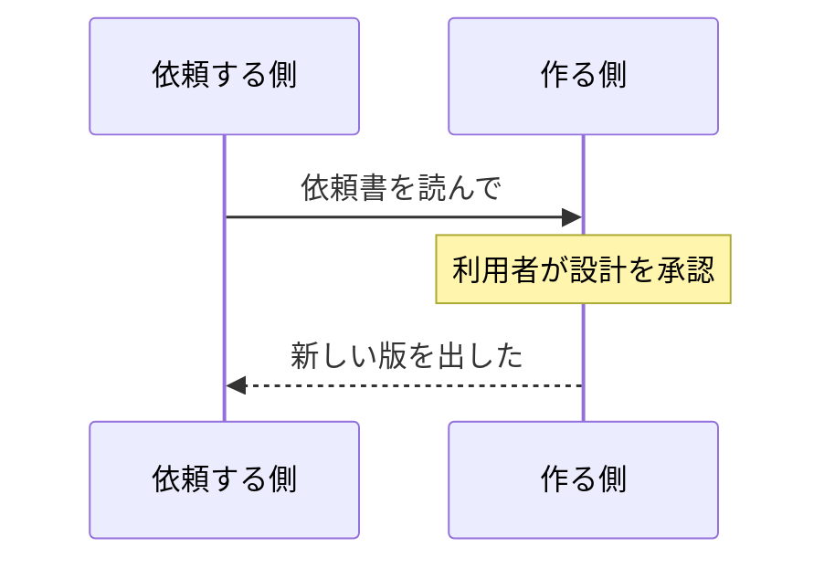
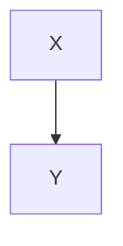

図はブラウザで描く。サーバーが出すのはコードブロックのまま。

## シーケンス図



## 流れ図と数式

```mermaid
flowchart LR
    A["$$x^2$$"] --> B{分かれ道}
    B -- はい --> C[<script>alert(1)</script>]
```

## 言語名の大文字

```Mermaid
pie title 割合
    "A" : 1
    "B" : 2
```

## ふつうのコード

```php
echo '<b>mermaid</b>';
```

:::example

:::
