Mermaid の図の種類ごとの見本。tests/mermaid.sh (BROWSER=1) が作る。
resource/mermaid-check/compare.html が、このページと「prototype.js を読まない写し」を描き比べる。

## flowchart

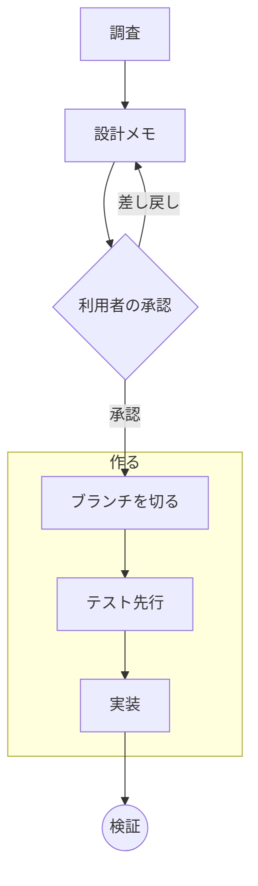

## sequence

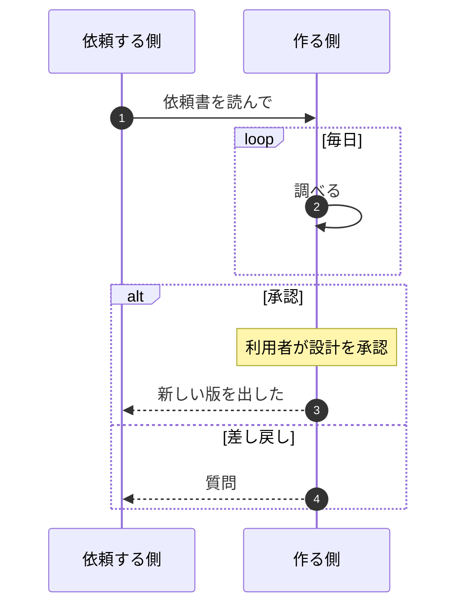

## class

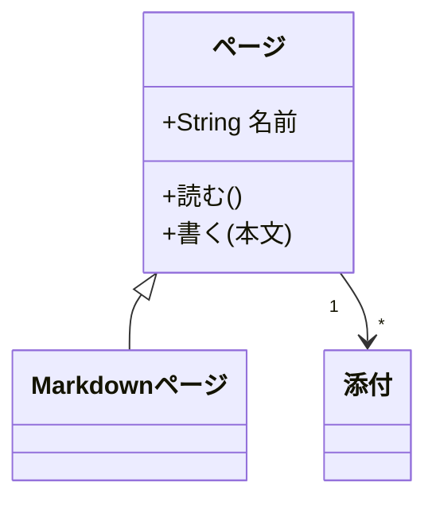

## state

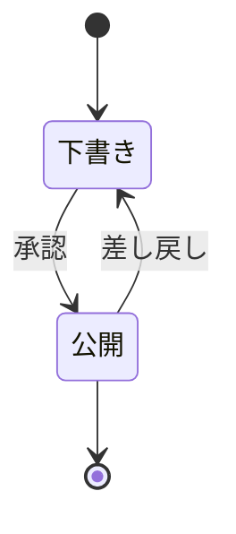

## er

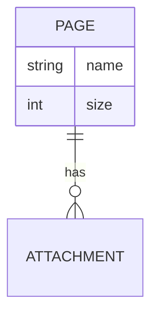

## gantt

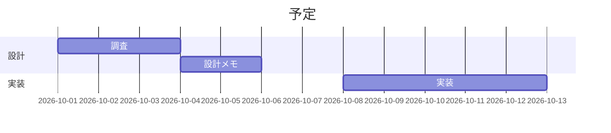

## pie

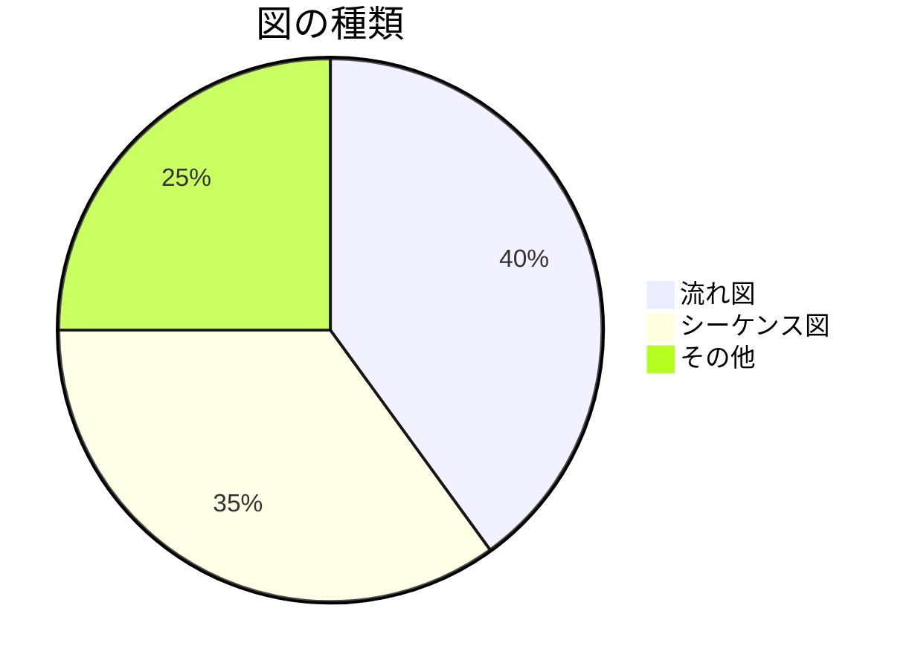

## journey

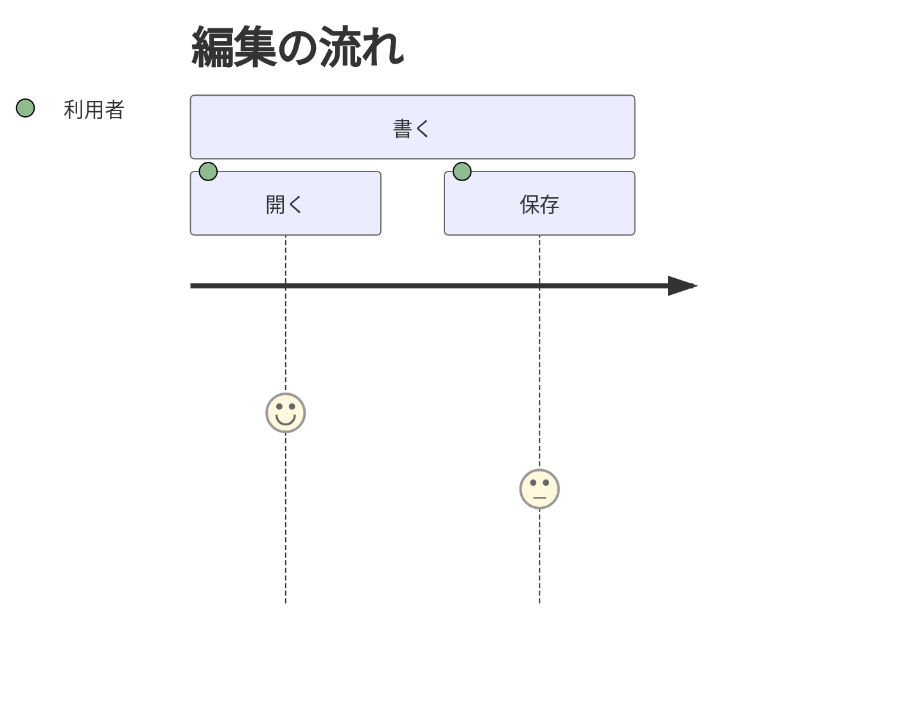

## gitgraph

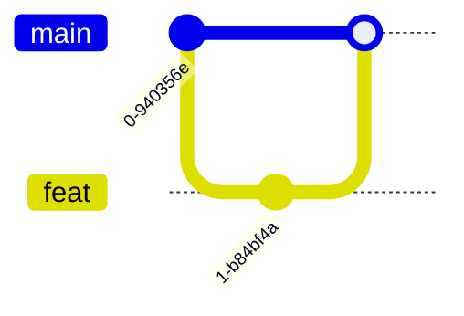

## mindmap

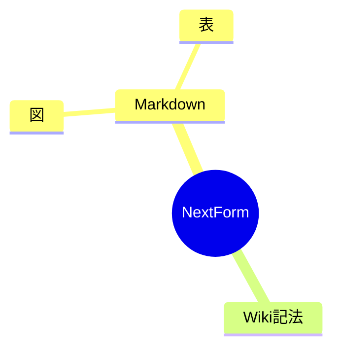

## timeline

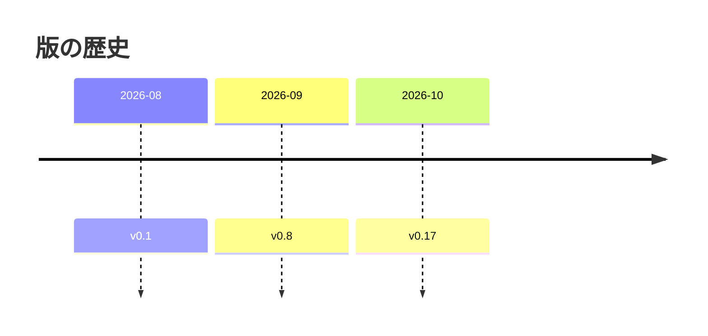

## quadrant

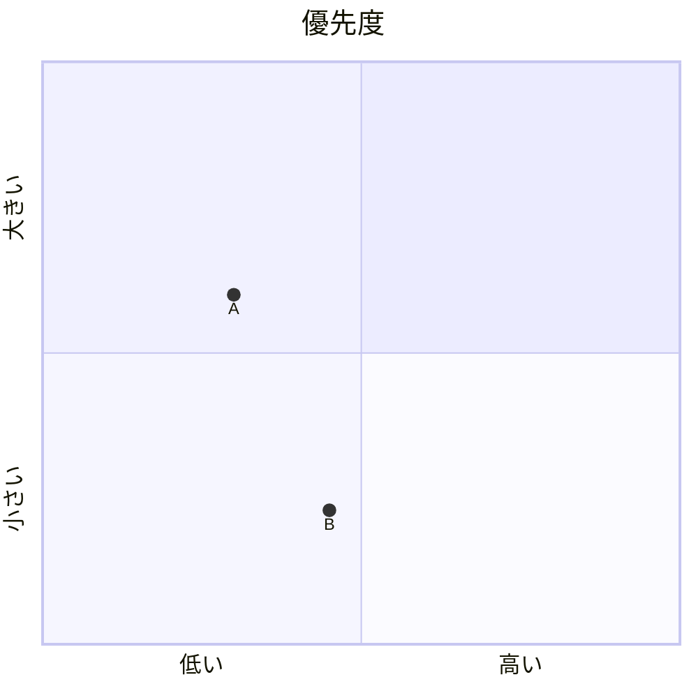

## sankey

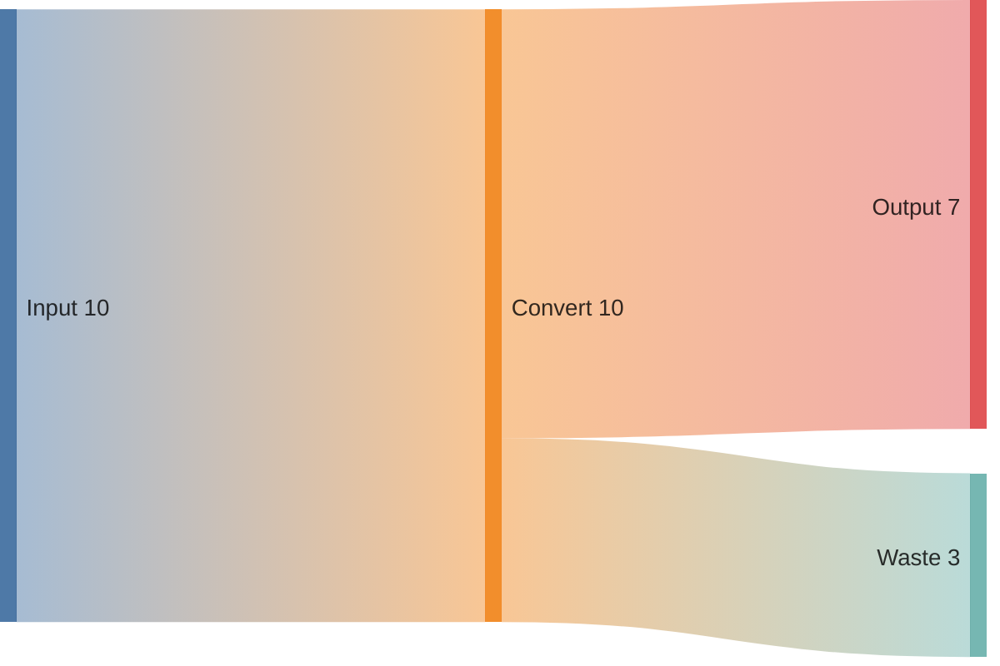

## xychart

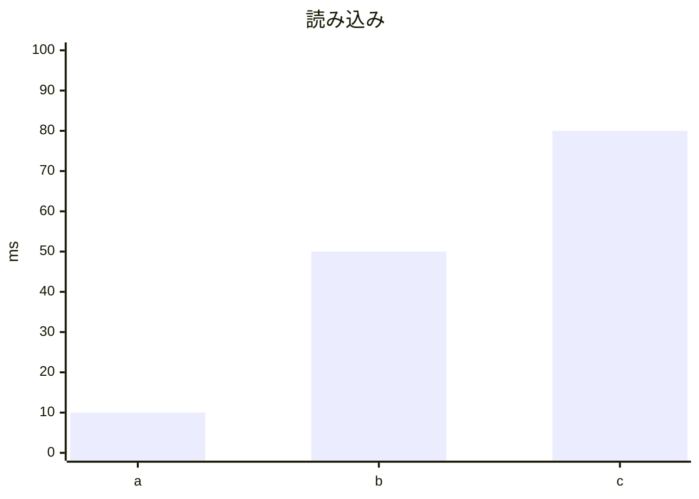

## block

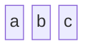

## packet

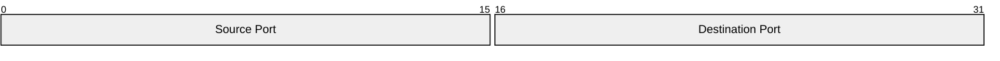

## kanban

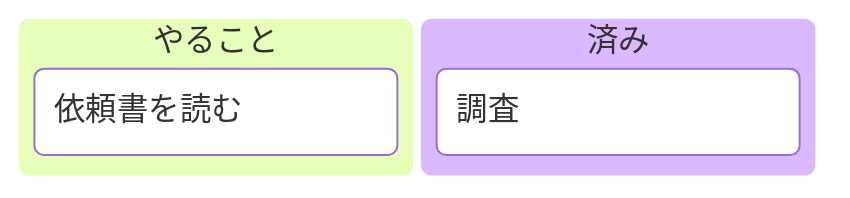

## architecture

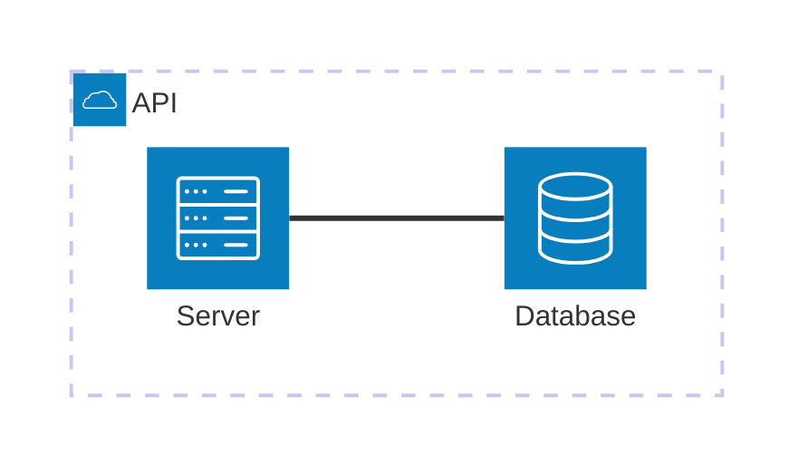

## radar

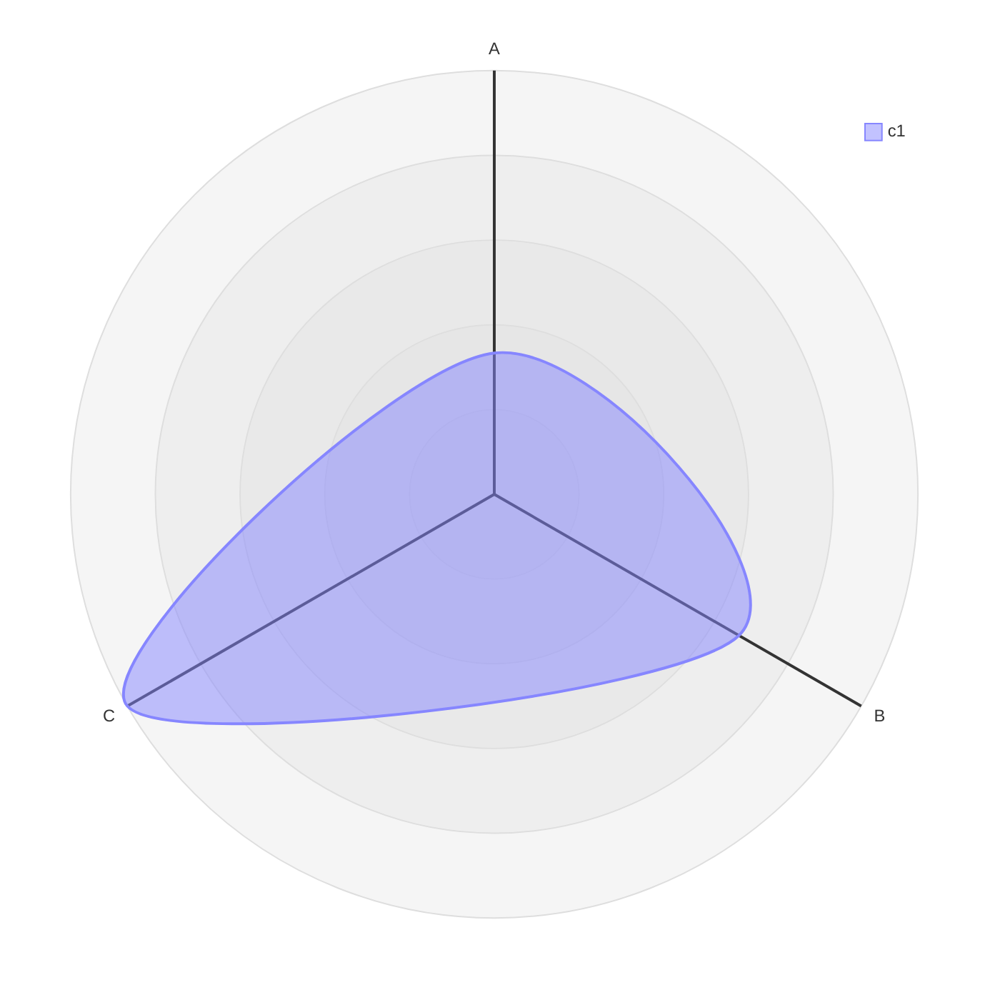

## treemap

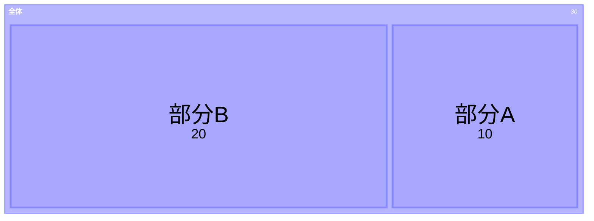

## requirement

```mermaid
requirementDiagram
    requirement r1 {
    id: 1
    text: "図を描く"
    risk: low
    verifymethod: test
    }
```

## c4

```mermaid
C4Context
    title 構成
    Person(u, "利用者")
    System(s, "NextForm")
    Rel(u, s, "使う")
```

## math

```mermaid
flowchart LR
    A["$$x^2 + y^2 = r^2$$"] --> B["$$\frac{a}{b}$$"]
```
