誰でも書ける wiki で、図の中に書かれても困らないことを確かめる見本。
tests/mermaid.sh (BROWSER=1) が作り、resource/mermaid-check/compare.html が中を調べる。
どれを開いても、アラートが出ず、フォーム・入力欄・外部の画像・ページを覆う箱が出ないこと。

## ラベルのスクリプト

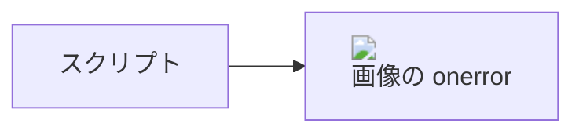

## ラベルのフォームと入力欄

```mermaid
flowchart LR
    A["<form action='https://example.invalid/'><input name=password type=password><button>送る</button></form>フォーム"]
```

## ラベルの style と外部の画像

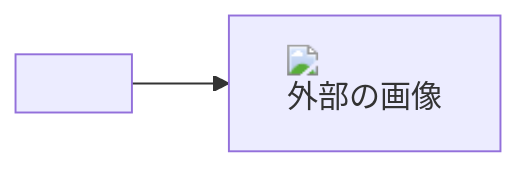

## javascript: のリンク

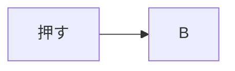

## 関数を呼ぶクリック

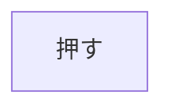

## 図の中の設定で securityLevel を緩める

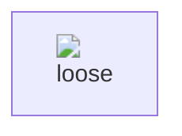

## フロントマターの設定で securityLevel を緩める

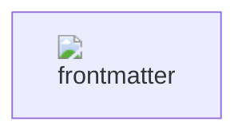

## themeCSS で外部を読む・ページを覆う

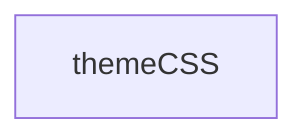

## fontFamily で外部を読む

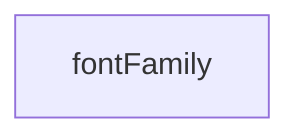

## シーケンス図のラベル

```mermaid
sequenceDiagram
    A->>B: <img src=x onerror="window.__nfProbe='sequence'">シーケンス
    Note over A: <form><input type=password></form>ノート
```

## ラベルの data- 属性で部分編集の範囲を偽る

ダブルクリックしても、この図の原文の範囲だけが開くこと (別の範囲や別のページが開かない)。

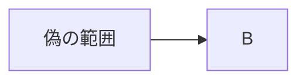

## 図の中の設定でラベルの許すタグを広げる

```mermaid
%%{init: {"dompurifyConfig": {"ALLOWED_TAGS": ["form", "input", "button"], "ALLOWED_ATTR": ["style", "type"]}}}%%
flowchart LR
    A["<form><input type=password><button>送る</button></form>設定で広げたフォーム"]
```

## 本文の幅を超える図 (useMaxWidth を切る)

本文の枠の外 (サイドの欄の上) にはみ出さず、横に送れること。

```mermaid
%%{init: {"flowchart": {"useMaxWidth": false}}}%%
flowchart LR
    A[横に長い図の 1 番目の節] --> B[横に長い図の 2 番目の節] --> C[横に長い図の 3 番目の節] --> D[横に長い図の 4 番目の節] --> E[横に長い図の 5 番目の節] --> F[横に長い図の 6 番目の節] --> G[横に長い図の 7 番目の節] --> H[横に長い図の 8 番目の節]
    H --> I[ここを押すと外のサイトへ]
    click I href "https://example.invalid/" "外へ"
```
